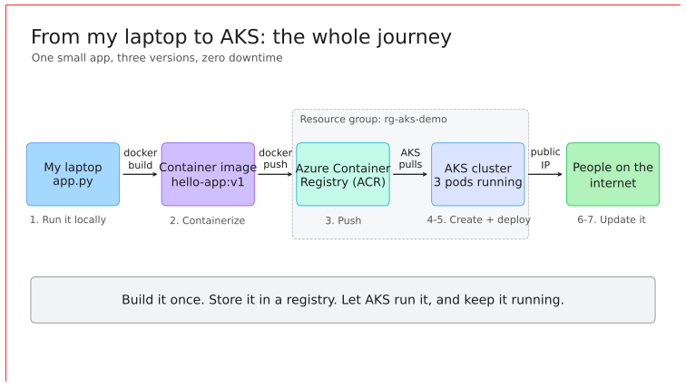
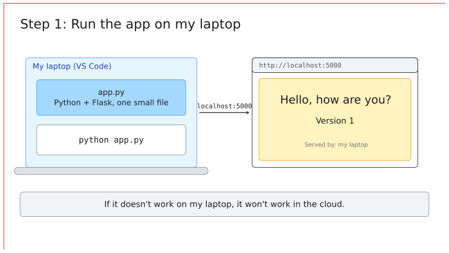
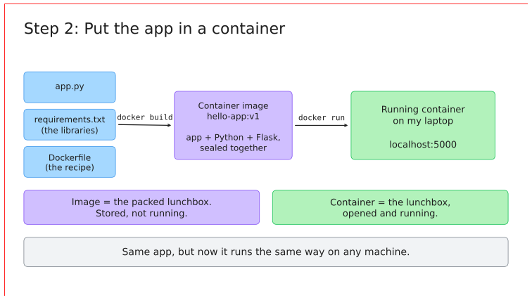
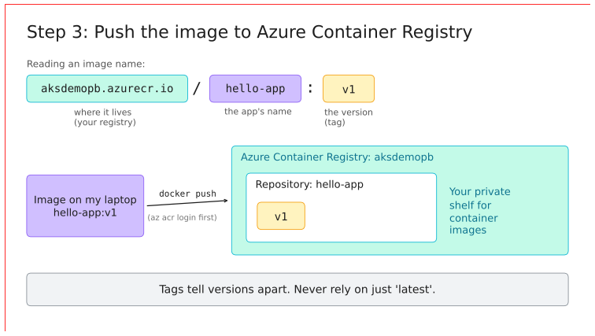
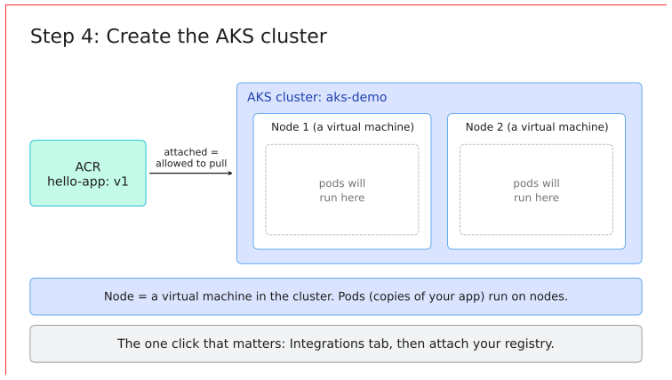
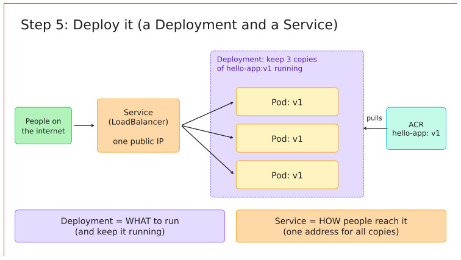
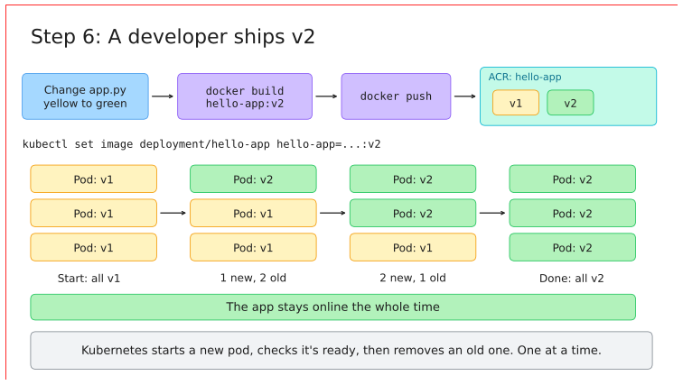
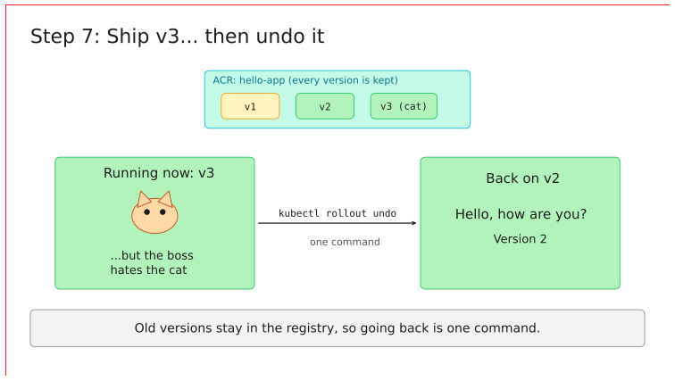
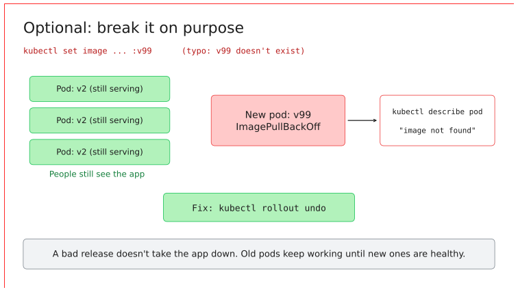
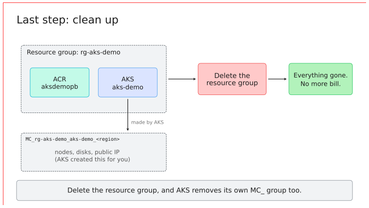

# Deploy your first app to AKS (step by step, beginner friendly)

Take a tiny Python app from your laptop, put it in a container, push it to **Azure Container Registry (ACR)**, and run it on **Azure Kubernetes Service (AKS)**. Then ship **two updates without downtime**, and **roll one back** with a single command.

Everything is done **by hand in the Azure portal** plus a few terminal commands. No pipelines, no Terraform, nothing hidden.



> 📺 This repo goes with the YouTube video on **@pratiekbanssal**. Follow along with the video, or use this README on its own.

---

## How to use this README

Every step ends with a **✅ Checkpoint**. **Don't move to the next step until your checkpoint matches.** If it doesn't, jump to [Troubleshooting](#troubleshooting).

---

## Contents

1. [What's in this repo](#whats-in-this-repo)
2. [The names used in this guide](#the-names-used-in-this-guide)
3. [Prerequisites (tools)](#prerequisites-tools)
4. [Permissions (RBAC) you need](#permissions-rbac-you-need)
5. [Step 1: Run the app on your laptop](#step-1-run-the-app-on-your-laptop)
6. [Step 2: Put the app in a container](#step-2-put-the-app-in-a-container)
7. [Step 3: Create the container registry (ACR)](#step-3-create-the-container-registry-acr)
8. [Step 4: Tag and push the image to ACR](#step-4-tag-and-push-the-image-to-acr)
9. [Step 5: Create the AKS cluster](#step-5-create-the-aks-cluster)
10. [Step 6: Connect to the cluster](#step-6-connect-to-the-cluster)
11. [Step 7: Deploy v1](#step-7-deploy-v1)
12. [Step 8: Ship v2 (rolling update)](#step-8-ship-v2-rolling-update)
13. [Step 9: Ship v3, then roll back](#step-9-ship-v3-then-roll-back)
14. [Optional: break it on purpose](#optional-break-it-on-purpose)
15. [Step 10: Clean up (don't skip this!)](#step-10-clean-up-dont-skip-this)
16. [Troubleshooting](#troubleshooting)
17. [Five Kubernetes words](#five-kubernetes-words)
18. [Diagrams](#diagrams)
19. [Prefer the CLI? (everything without the portal)](#prefer-the-cli-everything-without-the-portal)
20. [Microsoft Learn references](#microsoft-learn-references)

---

## What's in this repo

```
azure-aks-beginner-demo/
├── app/
│   ├── v1/   app.py, requirements.txt, Dockerfile   → yellow page, "Version 1"
│   ├── v2/   app.py, requirements.txt, Dockerfile   → green page,  "Version 2"
│   └── v3/   app.py, requirements.txt, Dockerfile   → green page + bouncing cat, "Version 3"
├── k8s/
│   ├── deployment.yaml   → WHAT to run (3 copies of the app)
│   └── service.yaml      → HOW people reach it (one public IP)
└── diagrams/
    ├── *.excalidraw      → open at https://excalidraw.com (File > Open)
    └── previews/*.png    → quick image previews
```

Each version's page also shows **"Served by pod: …"**, so you can see which copy of the app answered you.

---

## The names used in this guide

All commands below use these names, so you can copy and paste them.

| Thing | Name used here | Can I keep it? |
|---|---|---|
| Resource group | `rg-aks-demo` | ✅ Yes |
| AKS cluster | `aks-demo` | ✅ Yes |
| Container registry (ACR) | `aksdemopb` | ❌ **No.** Registry names are **globally unique**. Pick your own (5–50 lowercase letters/numbers, e.g. `aksdemo` + your initials) and replace `aksdemopb` everywhere, including in `k8s/deployment.yaml`. |
| Image name | `hello-app` | ✅ Yes |
| Image tags | `v1`, `v2`, `v3` | ✅ Yes |
| Region | your nearest (e.g. `New Zealand North`, `Australia East`, `East US`) | Use the **same region** for everything |

> **Tip:** Use your editor's Find & Replace on this README and `k8s/deployment.yaml`: replace `aksdemopb` with your registry name. Then every command is ready to go.

---

## Prerequisites (tools)

Install these **before** you start, then run the check command for each.

| Tool | Why you need it | Install | Check it works |
|---|---|---|---|
| **Azure subscription** | Where everything runs | [Free account](https://azure.microsoft.com/free/) | You can sign in at https://portal.azure.com |
| **Azure CLI** (`az`) | Log in to Azure and ACR, connect to AKS | [Install Azure CLI](https://learn.microsoft.com/cli/azure/install-azure-cli) | `az version` |
| **Docker Desktop** | Build and run containers | [Get Docker](https://docs.docker.com/get-started/get-docker/) | `docker version` (shows **Client** *and* **Server**) |
| **kubectl** | Talk to Kubernetes | `az aks install-cli` ([docs](https://learn.microsoft.com/cli/azure/aks#az-aks-install-cli)), or the copy bundled with Docker Desktop | `kubectl version --client` |
| **Python 3.10+** | Run the app locally in Step 1 | [python.org](https://www.python.org/downloads/) | `python --version` (on macOS/Linux you may need `python3`) |
| **VS Code** | Edit the files and run the terminal | [code.visualstudio.com](https://code.visualstudio.com/) | Opens fine |
| **Git** | Clone this repo | [git-scm.com](https://git-scm.com/downloads) | `git --version` |

Then clone the repo and sign in to Azure:

```bash
git clone https://github.com/pratiekbanssal/azure-aks-beginner-demo.git
cd azure-aks-beginner-demo
az login
az account show --output table
```

✅ **Checkpoint:** `az account show` prints the subscription you want to use. If you have several, switch with:
`az account set --subscription "<subscription name or id>"`

> 💸 **Cost:** ACR Basic costs a few dollars a month. AKS nodes are billed **per hour while they run**. Do the whole guide in one sitting and run [Step 10: Clean up](#step-10-clean-up-dont-skip-this) at the end.

---

## Permissions (RBAC) you need

Azure checks **who** is allowed to do **what**. Four permissions matter in this guide:

| # | Who | Needs to… | Role | How you get it |
|---|---|---|---|---|
| 1 | **You** | Create the resource group, ACR and AKS | **Contributor** (or Owner) on the subscription or resource group | Given by your subscription admin. You have **Owner** automatically on your own free/personal subscription. |
| 2 | **You** | Attach ACR to AKS (this *creates a role assignment*) | **Owner**, or **User Access Administrator** / **Role Based Access Control Administrator** together with Contributor | Same as above. Contributor **alone is not enough** for this step. |
| 3 | **You** | Push images to ACR | **AcrPush** on the registry (Owner/Contributor also work in the default mode) | Comes with Owner/Contributor in the default registry mode |
| 4 | **The AKS cluster** (its *kubelet managed identity*) | Pull images from ACR | **AcrPull** on the registry | ✨ **Created for you** when you attach ACR in Step 5. You don't assign it by hand. |
| 5 | **You** | Run `az aks get-credentials` to use `kubectl` | **Azure Kubernetes Service Cluster User Role** (Owner/Contributor include it) | Comes with Owner/Contributor |

### Check your roles

```bash
az role assignment list --assignee "$(az ad signed-in-user show --query id -o tsv)" --all --output table
```

✅ **Checkpoint:** you see **Owner**, or **Contributor** plus **User Access Administrator** (or **Role Based Access Control Administrator**), at subscription or resource group scope.

### ⚠️ One registry setting to leave alone

When you create the registry (Step 3), **Role assignment permissions mode** must be **RBAC Registry Permissions** (the default).

If you pick **RBAC Registry + ABAC Repository Permissions**, the classic `AcrPull`/`AcrPush` roles are **not honoured**. AKS then can't pull your image, even though everything looks right. [Why? (Microsoft Learn)](https://learn.microsoft.com/azure/container-registry/container-registry-rbac-abac-repository-permissions)

📖 More: [ACR roles overview](https://learn.microsoft.com/azure/container-registry/container-registry-rbac-built-in-roles-overview) · [Attach ACR to AKS](https://learn.microsoft.com/azure/aks/cluster-container-registry-integration) · [Who can download kubeconfig](https://learn.microsoft.com/azure/aks/control-kubeconfig-access)

---

## Step 1: Run the app on your laptop



```bash
cd app/v1
pip install -r requirements.txt
python app.py
```

Open **http://localhost:5000**.

✅ **Checkpoint:** a **yellow** page saying **"Hello, how are you?"** and **"Version 1"**.

Stop the app with **Ctrl + C**.

> If it doesn't work on your laptop, it won't work in the cloud. Get this step green first.

---

## Step 2: Put the app in a container



Still inside `app/v1`:

```bash
docker build --platform linux/amd64 -t hello-app:v1 .
docker run --rm -p 5000:5000 hello-app:v1
```

Open **http://localhost:5000** again.

✅ **Checkpoint:** the same yellow page, but now **"Served by pod:"** shows a random container ID. Stop it with **Ctrl + C**.

> **Why `--platform linux/amd64`?** AKS nodes are normally x86 (amd64) machines. On an Apple Silicon Mac (M1/M2/M3/M4), Docker builds ARM images by default, and AKS can't run them: you'd get `exec format error`, or a confusing `401`/`no match for platform` pull error. On Windows or an Intel Mac this flag is harmless, so **always include it**.

---

## Step 3: Create the container registry (ACR)

In the [Azure portal](https://portal.azure.com):

1. **Create a resource** → search **Container Registry** → **Create**.
2. **Resource group:** **Create new** → `rg-aks-demo`.
3. **Registry name:** `aksdemopb` (← use your own unique name).
4. **Location:** your region.
5. **Pricing plan:** **Basic**.
6. **Role assignment permissions mode:** keep **RBAC Registry Permissions** (see the [warning above](#-one-registry-setting-to-leave-alone)).
7. Leave everything else as default → **Review + create** → **Create**.
8. When it's done → **Go to resource** → on **Overview**, copy the **Login server**.

✅ **Checkpoint:** the registry exists, and you've noted its **Login server**. It's usually `aksdemopb.azurecr.io`.

> ⚠️ **Login server with a hash?** Some newer registries get a login server like `aksdemopb-abc123.azurecr.io` (a "domain name label" option). That's fine. Just use **exactly what Overview shows** wherever this guide says `aksdemopb.azurecr.io`, including in `k8s/deployment.yaml`.

📖 [Quickstart: Create a registry in the portal](https://learn.microsoft.com/azure/container-registry/container-registry-get-started-portal)

---

## Step 4: Tag and push the image to ACR



**How to read an image name:**

```
aksdemopb.azurecr.io / hello-app : v1
└── where it lives ──┘ └─ name ─┘ └ tag (version)
```

**4a. Log in to your registry** (use only the registry *name*, not the full `.azurecr.io` address):

```bash
az acr login --name aksdemopb
```

✅ **Checkpoint:** `Login Succeeded`.

**4b. Tag the image** with the registry address (this gives the image a second name that points at ACR):

```bash
docker tag hello-app:v1 aksdemopb.azurecr.io/hello-app:v1
docker images
```

✅ **Checkpoint:** `docker images` lists both `hello-app:v1` and `aksdemopb.azurecr.io/hello-app:v1`, with the **same IMAGE ID**.

**4c. Push it:**

```bash
docker push aksdemopb.azurecr.io/hello-app:v1
```

**4d. Confirm it's in ACR:**

```bash
az acr repository list --name aksdemopb --output table
az acr repository show-tags --name aksdemopb --repository hello-app --output table
```

✅ **Checkpoint:** you see repository `hello-app` with tag `v1`. In the portal: registry → **Repositories** → `hello-app` → `v1`.

> 🏷️ **Always tag a real version.** Never rely on `latest`: with versions you can see what's running *and* roll back.

📖 [`az acr login`](https://learn.microsoft.com/cli/azure/acr#az-acr-login) · [Push your first image (Docker CLI)](https://learn.microsoft.com/azure/container-registry/container-registry-get-started-docker-cli) · [`az acr repository`](https://learn.microsoft.com/cli/azure/acr/repository)

---

## Step 5: Create the AKS cluster



In the portal:

1. **Create a resource** → **Kubernetes Service** → choose the standard **Kubernetes cluster** (not "Automatic").
2. **Basics**
   - Resource group: `rg-aks-demo`
   - Cluster preset configuration: **Dev/Test**
   - Kubernetes cluster name: `aks-demo`
   - Region: **same as your ACR**
   - Availability zones: **None**
   - AKS pricing tier: **Free**
   - Leave the Kubernetes version as default
3. **Node pools:** keep the defaults. If you can, keep the node count small (1–2) to save money.
4. **Integrations** tab → **Container registry** → select **`aksdemopb`**. ⭐ **This is the most important click.** It gives the cluster the **AcrPull** permission on your registry.
5. **Review + create** → **Create**. This takes about 5–10 minutes.

✅ **Checkpoint:** the deployment says **"Your deployment is complete"**.

> **Forgot step 4, or it failed?** You can attach the registry afterwards (needs the Owner-type role from the [RBAC table](#permissions-rbac-you-need)):
> ```bash
> az aks update --resource-group rg-aks-demo --name aks-demo --attach-acr aksdemopb
> ```

> 💡 Portal labels move around occasionally. If something looks different, look for the closest match. The only setting that really matters is **attaching the registry**.

📖 [Quickstart: Create AKS in the portal](https://learn.microsoft.com/azure/aks/learn/quick-kubernetes-deploy-portal) · [Attach ACR to AKS](https://learn.microsoft.com/azure/aks/cluster-container-registry-integration)

---

## Step 6: Connect to the cluster

The portal shows these commands too: cluster → **Connect**.

```bash
az aks get-credentials --resource-group rg-aks-demo --name aks-demo
kubectl get nodes
```

✅ **Checkpoint:** one or more nodes with **STATUS = Ready**.

```
NAME                                STATUS   ROLES    AGE   VERSION
aks-agentpool-12345678-vmss000000   Ready    <none>   5m    v1.xx.x
```

**Double-check that AKS can pull from your registry** (optional, but a great guardrail):

```bash
az aks check-acr --resource-group rg-aks-demo --name aks-demo --acr aksdemopb.azurecr.io
```

✅ **Checkpoint:** the last lines of the output confirm that your cluster **can pull images** from `aksdemopb.azurecr.io`.

📖 [`az aks get-credentials`](https://learn.microsoft.com/cli/azure/aks#az-aks-get-credentials) · [`az aks check-acr`](https://learn.microsoft.com/cli/azure/aks#az-aks-check-acr)

---

## Step 7: Deploy v1



Go back to the **repo root** (the folder with `k8s/`), then:

```bash
cd ../..
kubectl apply -f k8s/deployment.yaml
kubectl apply -f k8s/service.yaml
```

> Did you change `aksdemopb` in `k8s/deployment.yaml` to your registry's login server? If not, do it now and run the apply again.

Watch the pods start:

```bash
kubectl get pods
```

✅ **Checkpoint:** 3 pods named `hello-app-…`, all **Running** and **READY 1/1**.

Get the public IP:

```bash
kubectl get service hello-app --watch
```

Wait until **EXTERNAL-IP** changes from `<pending>` to an IP address (about 1–2 minutes), then press **Ctrl + C**.

Open **http://&lt;EXTERNAL-IP&gt;** in your browser.

✅ **Checkpoint:** the yellow **Version 1** page, now live on the internet from AKS. 🎉

> **What did we just create?**
> - **Deployment** = *what* to run: "keep 3 copies of `hello-app:v1` running."
> - **Service** = *how* people reach it: "one public IP that spreads traffic across the 3 copies."

---

## Step 8: Ship v2 (rolling update)



The story: *the designer wants green.* `app/v2` already has the change.

**8a. Build, tag and push v2:**

```bash
cd app/v2
docker build --platform linux/amd64 -t hello-app:v2 .
docker tag hello-app:v2 aksdemopb.azurecr.io/hello-app:v2
docker push aksdemopb.azurecr.io/hello-app:v2
az acr repository show-tags --name aksdemopb --repository hello-app --output table
cd ../..
```

✅ **Checkpoint:** ACR now shows **v1** and **v2**.

**8b. Roll it out.** Use **two terminals** side by side so you can watch it happen.

Terminal 2 (the watcher):

```bash
kubectl get pods --watch
```

Terminal 1 (the update):

```bash
kubectl set image deployment/hello-app hello-app=aksdemopb.azurecr.io/hello-app:v2
kubectl rollout status deployment/hello-app
```

✅ **Checkpoint:**
- Terminal 2 shows new pods starting and old ones terminating, **one at a time**.
- Terminal 1 ends with `deployment "hello-app" successfully rolled out`.
- Refresh the browser and you see a **green** page saying **"Version 2"**.

> **Why no downtime?** Kubernetes starts a new pod, waits for its **readiness check** (in `deployment.yaml`) to pass, and only then removes an old pod.

> **The browser keeps showing the same pod name?** Normal. Browsers reuse connections. Try a private window, or run `curl -s http://<EXTERNAL-IP> | grep pod` a few times.

---

## Step 9: Ship v3, then roll back



The story: *product wants a mascot.*

```bash
cd app/v3
docker build --platform linux/amd64 -t hello-app:v3 .
docker tag hello-app:v3 aksdemopb.azurecr.io/hello-app:v3
docker push aksdemopb.azurecr.io/hello-app:v3
cd ../..
kubectl set image deployment/hello-app hello-app=aksdemopb.azurecr.io/hello-app:v3
kubectl rollout status deployment/hello-app
```

✅ **Checkpoint:** a green page with a **bouncing cat** saying **"Version 3"**.

Now *the boss hates the cat.* Undo it:

```bash
kubectl rollout history deployment/hello-app
kubectl rollout undo deployment/hello-app
kubectl rollout status deployment/hello-app
```

✅ **Checkpoint:** you're back to the green **Version 2** page with no cat.

> This works because every version is still sitting in ACR. **Tags make rollback a one-liner.**

---

## Optional: break it on purpose



**A. Bad release (typo in the tag):**

```bash
kubectl set image deployment/hello-app hello-app=aksdemopb.azurecr.io/hello-app:v99
kubectl get pods
```

✅ **Checkpoint:** one new pod shows **ErrImagePull** / **ImagePullBackOff**, while the old pods keep **Running**, so the site still works.

Read the error, then fix it:

```bash
kubectl describe pod <name-of-the-broken-pod>
kubectl rollout undo deployment/hello-app
```

**B. Self-healing:**

```bash
kubectl get pods
kubectl delete pod <any-hello-app-pod-name>
kubectl get pods
```

✅ **Checkpoint:** a replacement pod appears straight away. The Deployment keeps 3 copies running.

---

## Step 10: Clean up (don't skip this!)



**Portal:** **Resource groups** → `rg-aks-demo` → **Delete resource group** → type the name → **Delete**.

**Or CLI:**

```bash
az group delete --name rg-aks-demo --yes --no-wait
```

AKS also created a second resource group for its nodes, called `MC_rg-aks-demo_aks-demo_<region>`. **It's deleted automatically** along with the cluster.

✅ **Checkpoint (after a few minutes):**

```bash
az group list --output table
```

Neither `rg-aks-demo` nor `MC_rg-aks-demo_…` is listed.

Optional, to tidy your laptop:

```bash
kubectl config delete-context aks-demo
docker rmi hello-app:v1 hello-app:v2 hello-app:v3 aksdemopb.azurecr.io/hello-app:v1 aksdemopb.azurecr.io/hello-app:v2 aksdemopb.azurecr.io/hello-app:v3
```

---

## Troubleshooting

| You see… | Most likely cause | Fix |
|---|---|---|
| `python: command not found` | macOS/Linux uses `python3` | Use `python3 app.py` and `pip3 install -r requirements.txt` |
| Page doesn't load at localhost:5000 | The app isn't running, or the port is busy | Check the terminal for errors. Close anything else on port 5000 (on macOS, *AirPlay Receiver* uses 5000: turn it off in System Settings). |
| `Cannot connect to the Docker daemon` | Docker Desktop isn't running | Start Docker Desktop and wait until it says "running" |
| `az acr login` fails | Docker isn't running, or you're logged in to the wrong subscription | Start Docker. Run `az account show` and switch with `az account set` |
| `docker push`: `unauthorized` / `insufficient_scope` | Not logged in to ACR, or missing **AcrPush** | Re-run `az acr login --name aksdemopb`. Check [roles](#permissions-rbac-you-need). |
| `az acr login` works but the image name is "not found" when pushing | Wrong registry address in the tag | Use the exact **Login server** from the registry's Overview page |
| Pod stuck in **ImagePullBackOff** / **ErrImagePull** | (1) typo in the image name/tag, (2) ACR not attached, (3) ABAC registry mode, (4) ARM image from an Apple Silicon Mac | Run `kubectl describe pod <pod>` and read **Events**. (1) fix the name in `deployment.yaml`; (2) `az aks update -g rg-aks-demo -n aks-demo --attach-acr aksdemopb`; (3) see the [ABAC warning](#-one-registry-setting-to-leave-alone); (4) rebuild with `--platform linux/amd64` and push again. Run `az aks check-acr` to confirm. |
| Pod **CrashLoopBackOff** with `exec format error` | ARM image on an x86 node | Rebuild with `--platform linux/amd64`, push, `kubectl rollout restart deployment/hello-app` |
| Attaching ACR fails with an authorization error | You don't have permission to create role assignments | You need **Owner**, or **User Access Administrator** / **RBAC Administrator** ([RBAC table](#permissions-rbac-you-need)) |
| `az aks get-credentials` fails: forbidden | Missing **Azure Kubernetes Service Cluster User Role** | Ask your admin, or use an account with Contributor/Owner |
| `kubectl: command not found` | kubectl isn't installed | `az aks install-cli`, then open a new terminal |
| EXTERNAL-IP stuck on `<pending>` for over 5 minutes | Still provisioning, or a public IP quota issue | Run `kubectl describe service hello-app` and read **Events** |
| Cluster creation fails: quota / SKU not available | Free/trial subscriptions have small vCPU limits | Use the **Dev/Test** preset, 1 node, or try another region |

📖 [Troubleshoot AKS image pull errors from ACR (Microsoft Learn)](https://learn.microsoft.com/troubleshoot/azure/azure-kubernetes/connectivity/cannot-pull-image-from-acr-to-aks-cluster)

---

## Five Kubernetes words

| Word | In one line |
|---|---|
| **Pod** | One running copy of your container. |
| **Node** | A virtual machine in the cluster. Pods run on nodes. |
| **Deployment** | "Run 3 copies of my app from this image, and keep them running." |
| **Service** | One address for all the copies. `LoadBalancer` = a public IP. |
| **Rolling update** | New pods replace old ones one at a time, so the app never goes down. |

---

## Diagrams

All diagrams are in [`diagrams/`](diagrams/) as **Excalidraw** files. To view or edit them:

1. Go to **https://excalidraw.com**.
2. **Menu → Open** (or drag the file onto the page).
3. Pick any `.excalidraw` file.

`00-all-scenes.excalidraw` has every scene in one canvas, each in its own frame.

| File | Shows |
|---|---|
| `01-the-whole-journey` | The full path: laptop → image → ACR → AKS → internet |
| `02-run-it-on-my-laptop` | Step 1 |
| `03-put-it-in-a-container` | Image vs container |
| `04-push-to-acr` | Reading an image name, `docker push` |
| `05-create-the-aks-cluster` | Cluster, nodes, attaching ACR |
| `06-five-kubernetes-words` | Cheat sheet |
| `07-deployment-and-service` | What to run vs how people reach it |
| `08-ship-v2-rolling-update` | Rolling update, stage by stage |
| `09-ship-v3-then-undo` | Rollback |
| `10-break-it-on-purpose` | ImagePullBackOff, and why the site stays up |
| `11-clean-up` | Deleting the resource group (and the MC_ group) |

---

## Prefer the CLI? (everything without the portal)

Same result as Steps 3 and 5, using only commands. Change `aksdemopb` and the location first.

```bash
az group create --name rg-aks-demo --location australiaeast

az acr create --resource-group rg-aks-demo --name aksdemopb --sku Basic

az aks create --resource-group rg-aks-demo --name aks-demo --node-count 1 --generate-ssh-keys --attach-acr aksdemopb
```

Then continue from [Step 4](#step-4-tag-and-push-the-image-to-acr) (push) and [Step 6](#step-6-connect-to-the-cluster) (connect).

📖 [`az acr create`](https://learn.microsoft.com/cli/azure/acr#az-acr-create) · [`az aks create`](https://learn.microsoft.com/cli/azure/aks#az-aks-create)

---

## Microsoft Learn references

**Container registry (ACR)**
- [Quickstart: Create a registry in the Azure portal](https://learn.microsoft.com/azure/container-registry/container-registry-get-started-portal)
- [Push your first image with the Docker CLI](https://learn.microsoft.com/azure/container-registry/container-registry-get-started-docker-cli)
- [`az acr login`](https://learn.microsoft.com/cli/azure/acr#az-acr-login) · [`az acr repository`](https://learn.microsoft.com/cli/azure/acr/repository) · [`az acr create`](https://learn.microsoft.com/cli/azure/acr#az-acr-create)
- [ACR roles and permissions overview](https://learn.microsoft.com/azure/container-registry/container-registry-rbac-built-in-roles-overview)
- [ABAC repository permissions (and why AcrPull/AcrPush stop working)](https://learn.microsoft.com/azure/container-registry/container-registry-rbac-abac-repository-permissions)

**Kubernetes service (AKS)**
- [Quickstart: Deploy an AKS cluster in the Azure portal](https://learn.microsoft.com/azure/aks/learn/quick-kubernetes-deploy-portal)
- [Authenticate with ACR from AKS (attach ACR)](https://learn.microsoft.com/azure/aks/cluster-container-registry-integration)
- [`az aks get-credentials`](https://learn.microsoft.com/cli/azure/aks#az-aks-get-credentials) · [`az aks check-acr`](https://learn.microsoft.com/cli/azure/aks#az-aks-check-acr) · [`az aks install-cli`](https://learn.microsoft.com/cli/azure/aks#az-aks-install-cli) · [`az aks create`](https://learn.microsoft.com/cli/azure/aks#az-aks-create)
- [Control who can download kubeconfig (Cluster User/Admin roles)](https://learn.microsoft.com/azure/aks/control-kubeconfig-access)
- [Troubleshoot image pull errors from ACR](https://learn.microsoft.com/troubleshoot/azure/azure-kubernetes/connectivity/cannot-pull-image-from-acr-to-aks-cluster)

**Kubernetes basics**
- [Kubernetes core concepts for AKS](https://learn.microsoft.com/azure/aks/concepts-clusters-workloads)
- [Deployments](https://kubernetes.io/docs/concepts/workloads/controllers/deployment/) · [Services](https://kubernetes.io/docs/concepts/services-networking/service/) (kubernetes.io)

---

If this helped, ⭐ the repo and tell me in the YouTube comments where you got stuck. The most common questions become the next videos.
